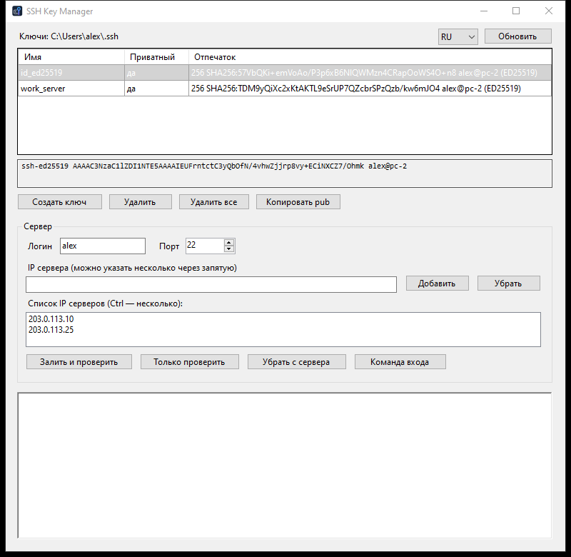
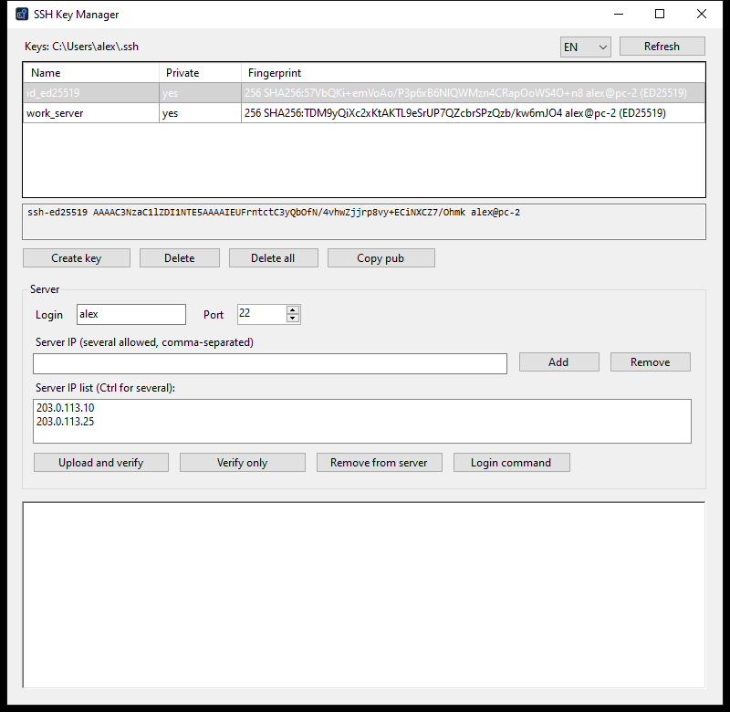

<p align="center">
  
</p>

<h1 align="center">SSH Key Manager</h1>

<p align="center">
  Простой менеджер SSH-ключей для Windows: создать ключ, залить его на серверы и проверить вход.<br>
  A simple SSH key manager for Windows: create a key, upload it to servers and check the login.
</p>

<p align="center">
  <a href="#русский">Русский</a> | <a href="#english">English</a>
</p>

# Русский

Небольшая программа с окном для тех, кто не хочет вручную возиться с `ssh-keygen`, `authorized_keys` и правами на файлы. Работает со стандартным OpenSSH, встроенным в Windows, ничего дополнительно ставить не нужно.



## Возможности

- Список ключей из `%USERPROFILE%\.ssh` с отпечатками; создание (ed25519) и удаление ключей, копирование публичного ключа в буфер обмена.
- Заливка ключа на один или несколько серверов с проверкой входа: ключ добавляется в `~/.ssh/authorized_keys` без дубликатов, права `700`/`600` выставляются автоматически.
- Проверка, пускает ли сервер по ключу, без изменений на сервере.
- Удаление ключа с сервера: удаляется только строка с этим ключом, остальные ключи не трогаются.
- Готовая команда входа (`ssh -i ... user@host`) в буфер обмена.
- Список серверов, логин и порт запоминаются между запусками.
- Интерфейс на русском и английском, язык переключается в окне.

## Требования

- Windows 10 1809 и новее или Windows 11 (там уже есть .NET Framework 4.x и клиент OpenSSH).
- Если клиента OpenSSH нет: "Параметры" → "Приложения" → "Дополнительные компоненты" → "Клиент OpenSSH".
- На серверах: Linux или другая Unix-система с `sh`, `awk`, `grep`, `mktemp`, `base64`.

## Установка

Скачайте `SSH-Key-Manager.exe` со страницы [Releases](https://github.com/0fells/ssh-key-manager/releases/latest) и запустите. Установка не нужна. Контрольная сумма лежит там же, в `SHA256SUMS`.

## Сборка

Отдельные инструменты не нужны, используется компилятор C# из состава Windows:

```
build.cmd
```

Рядом появится `SSH-Key-Manager.exe`.

## Как пользоваться

1. Нажмите "Создать ключ" (или выберите существующий ключ в списке).
2. Укажите логин, порт и IP сервера, добавьте его в список.
3. Нажмите "Залить и проверить" и введите пароль сервера в открывшемся окне ssh. Это нужно один раз: дальше вход идёт по ключу.
4. "Только проверить" показывает, работает ли вход по ключу; "Убрать с сервера" отзывает ключ.

## Ограничения

- Пароль ключа передаётся `ssh-keygen` в командной строке и на время создания ключа виден другим программам вашего пользователя Windows. Если это важно, создайте ключ без пароля или через `ssh-keygen` в консоли.
- При первом подключении ключ сервера принимается без проверки (`StrictHostKeyChecking=accept-new`).
- Заливка и удаление ключа на серверах с Windows OpenSSH не поддерживаются.

## Лицензия

[MIT](LICENSE)

# English

A small GUI program for people who don't want to deal with `ssh-keygen`, `authorized_keys` and file permissions by hand. It uses the standard OpenSSH client built into Windows; nothing else to install.



## Features

- Lists keys in `%USERPROFILE%\.ssh` with fingerprints; creates (ed25519) and deletes keys, copies the public key to the clipboard.
- Uploads a key to one or more servers and checks the login: the key is added to `~/.ssh/authorized_keys` without duplicates, `700`/`600` permissions are set automatically.
- Checks whether a server accepts the key, without changing anything on the server.
- Removes a key from a server: only the line with this key is removed, other keys stay.
- Copies a ready login command (`ssh -i ... user@host`) to the clipboard.
- Remembers the server list, login and port between runs.
- Russian and English interface, switchable in the window.

## Requirements

- Windows 10 1809 or later, or Windows 11 (they already include .NET Framework 4.x and the OpenSSH client).
- If the OpenSSH client is missing: "Settings" → "Apps" → "Optional features" → "OpenSSH Client".
- On servers: Linux or another Unix system with `sh`, `awk`, `grep`, `mktemp`, `base64`.

## Installation

Download `SSH-Key-Manager.exe` from [Releases](https://github.com/0fells/ssh-key-manager/releases/latest) and run it. No installation needed. The checksum is in `SHA256SUMS` next to it.

## Building

No extra tools needed, the C# compiler shipped with Windows is used:

```
build.cmd
```

`SSH-Key-Manager.exe` appears next to it.

## Usage

1. Click "Create key" (or pick an existing key in the list).
2. Enter the login, port and server IP, add it to the list.
3. Click "Upload and verify" and type the server password in the ssh window that opens. This is needed once: after that the key is used.
4. "Verify only" shows whether key login works; "Remove from server" revokes the key.

## Limitations

- The key passphrase is passed to `ssh-keygen` on the command line and is visible to other programs of your Windows user while the key is being created. If that matters, create the key without a passphrase or with `ssh-keygen` in a console.
- On first connection the server host key is accepted without verification (`StrictHostKeyChecking=accept-new`).
- Uploading and removing keys on Windows OpenSSH servers is not supported.

## License

[MIT](LICENSE)
